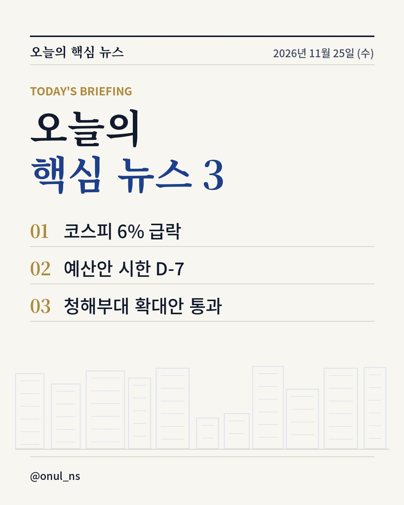
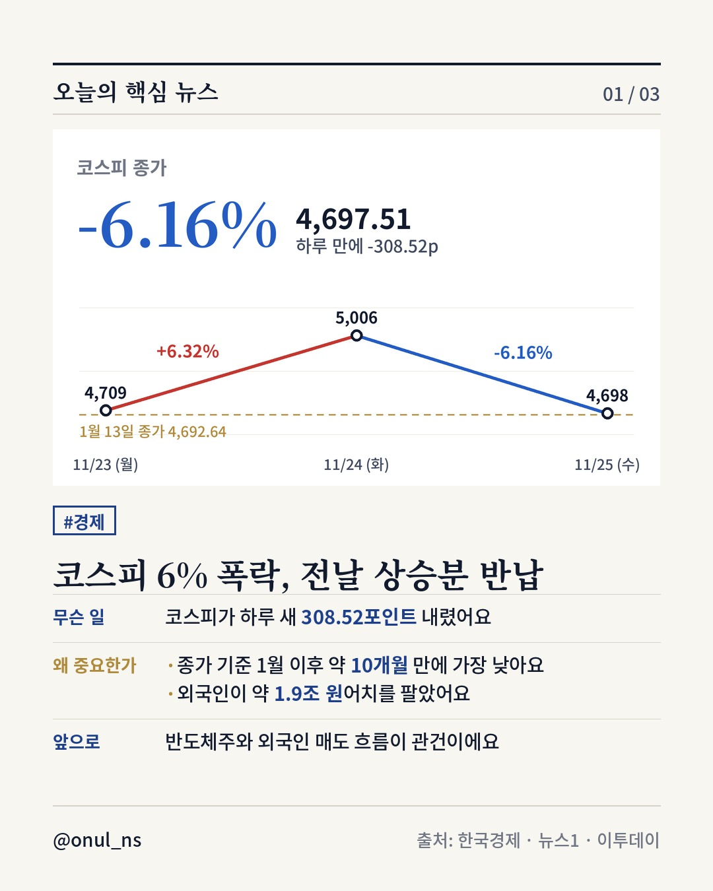
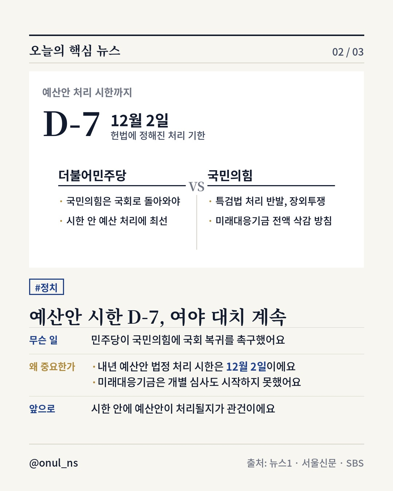
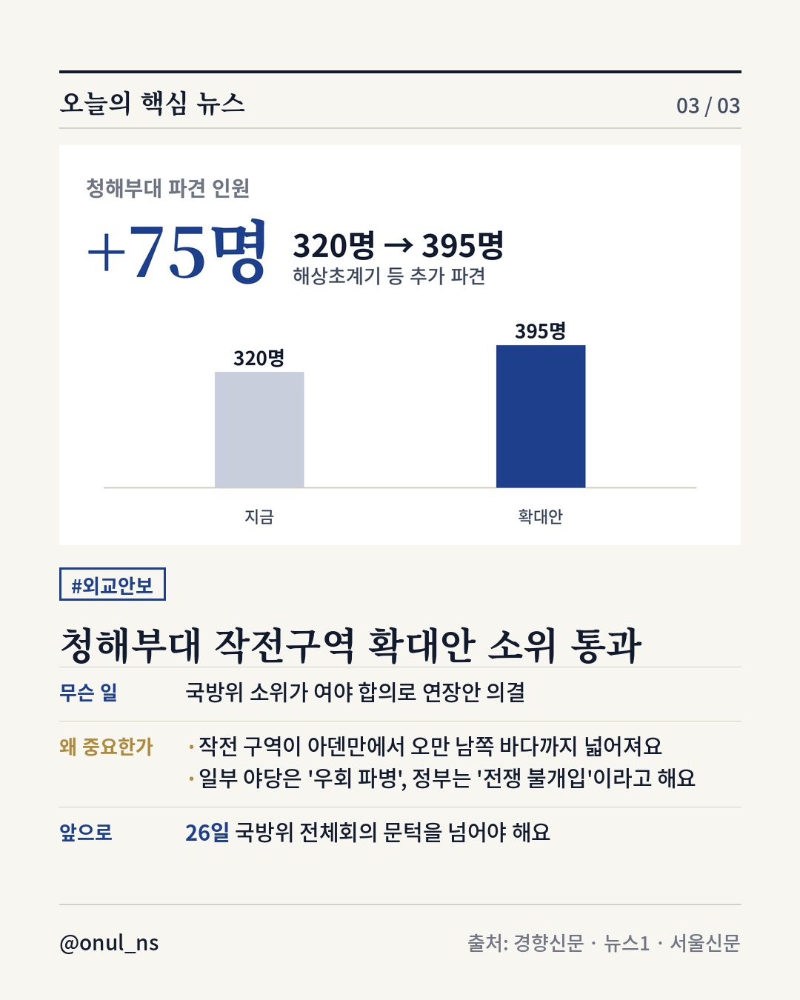
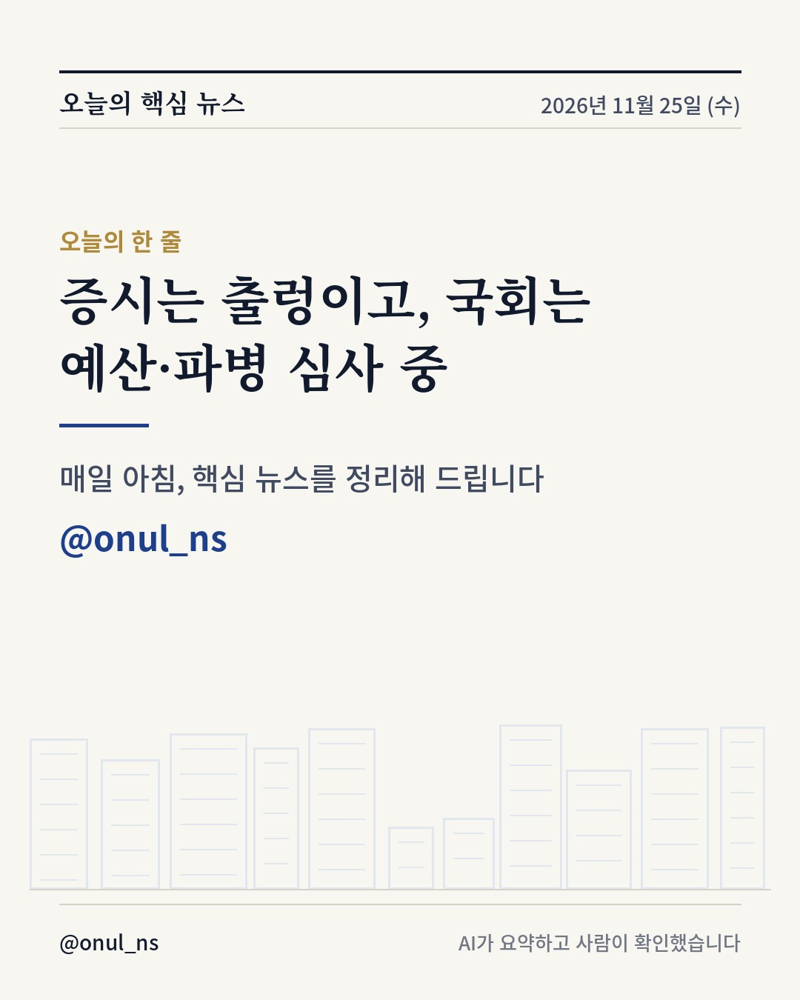

# 11월 25일 (수) 오늘의 핵심 뉴스

[← 보관함 목차](../README.md)

## 카드







## 캡션 (그대로 복사)

```
오늘 코스피가 6% 넘게 떨어지며 4,697로 마감해 10개월 만에 가장 낮아졌어요. 내년 예산안 처리 시한(12월 2일)이 7일 남은 가운데, 민주당은 장외투쟁 중인 국민의힘에 국회 복귀를 촉구했어요. 청해부대 작전 구역을 오만 남쪽 바다까지 넓히는 파견 연장안은 국방위 소위를 통과했어요.

출처: 한국경제 · 뉴스1 · 이투데이 · 세계일보 · 서울신문 · SBS · 경향신문
※ AI가 요약하고 사람이 확인했습니다

#오늘의뉴스 #시사 #뉴스요약 #코스피 #증시 #예산안 #국회 #청해부대 #국방 #카드뉴스
```

## 왜 이 뉴스인가 (게시용 아님)

1. **코스피 6% 폭락, 전날 상승분 반납** (중요): 주식·연금을 가진 많은 사람의 돈에 바로 영향을 주는 경제 톱뉴스 · 출처 한국경제 · 뉴스1 · 이투데이
2. **예산안 시한 D-7, 여야 대치 계속** (중요): 내년 나라 살림이 걸린 일정이고, 시한을 지킬지 불확실 · 출처 뉴스1 · 서울신문 · SBS
3. **청해부대 작전구역 확대안 소위 통과** (중요): 해외 파견 범위가 바뀌는 일이고 전쟁 개입 여부가 쟁점 · 출처 경향신문 · 뉴스1 · 서울신문

## 사실 확인 결과 (게시용 아님)

※ 이날은 시험용 3개짜리(새 디자인 첫 제작). 언론사 사이트 접속이 막혀 기사 원문 대신 검색 결과로 확인.

1. 코스피: 4,697.51 마감·-6.16%는 5곳 숫자 일치. 그래프의 24일 종가 5,006 = 4,697.51 + 308.52, 23일 종가 4,709 = 5,006.03 - 297.49로 계산. 외국인 순매도는 1조 8,993억(한국경제)·1조 9,085억(뉴스1)으로 달라 '약 1.9조'.
https://www.hankyung.com/article/202611259903i
https://www.news1.kr/finance/market-exr/6365864
https://www.segye.com/newsView/20261125515667

2. 예산안: 12월 2일 시한·복귀 촉구는 뉴스1, 미래대응기금 심사 지연은 서울신문. 국민의힘 '미래대응기금 전액 삭감 방침'은 이달 초 보도.
https://www.news1.kr/politics/assembly/6365256
https://www.seoul.co.kr/news/politics/2026/11/26/20261126003001

3. 청해부대: 320명→395명은 뉴스1, 소위 통과·전쟁 불개입 부대의견은 경향신문·서울신문.
https://www.khan.co.kr/article/202611251717001/
https://www.news1.kr/politics/assembly/6365959
https://www.seoul.co.kr/news/politics/2026/11/25/20261125500314

뺀 뉴스: 서울 지하철 협상 타결(1곳만 보도), 조희대 탄핵 당론(11/20 뉴스), 한한령 해제(11/18 뉴스), 남해고속도로 사고(사건사고).
