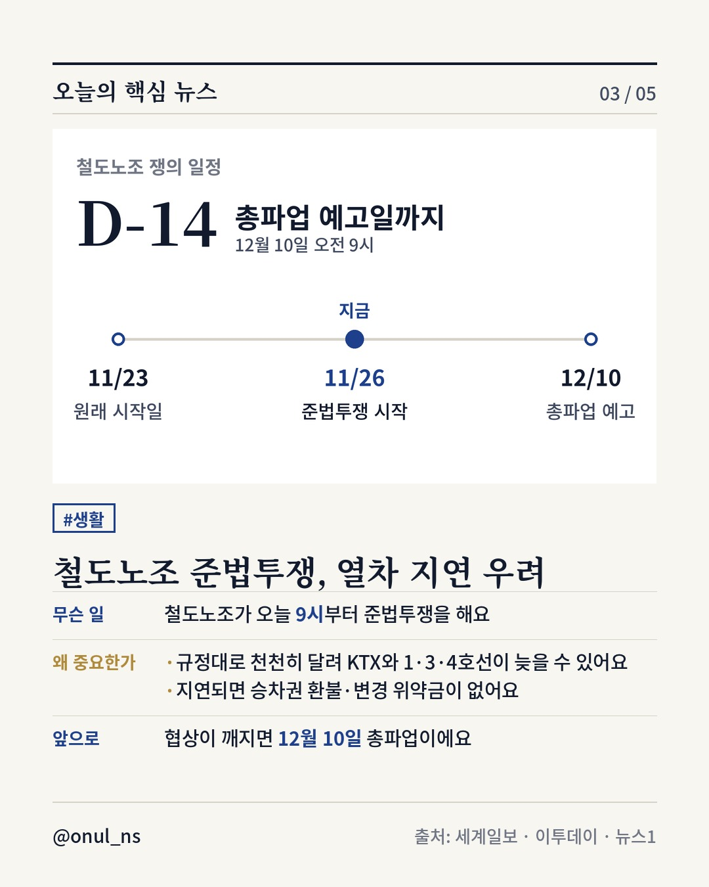
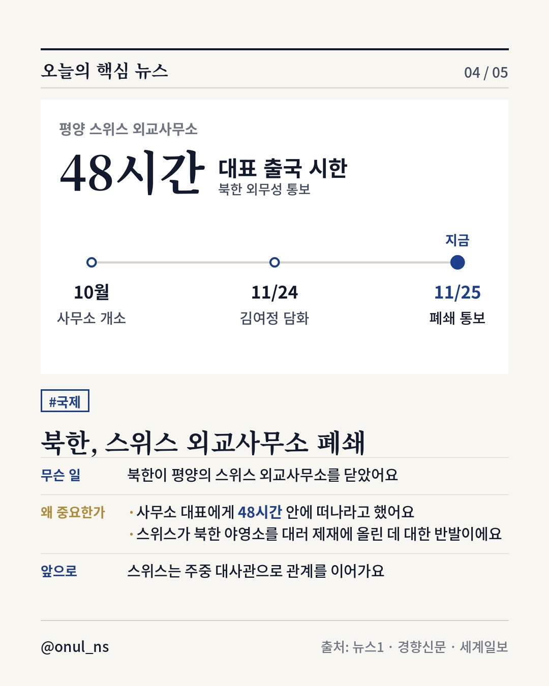

# 11월 26일 (목) 오늘의 핵심 뉴스

[← 보관함 목차](../README.md)

## 카드






## 캡션 (그대로 복사)

```
미국이 14개 경제권에 새 관세를 제안했고, 한국은 기존 합의대로 상한 15%가 유지돼요.
10월 은행 가계대출 금리가 5.02%로 2023년 11월 이후 처음 5%를 넘었고, 한국은행은 오늘 기준금리를 정해요.
철도노조가 오늘 오전 9시부터 준법투쟁에 들어가 KTX와 수도권 전철이 늦을 수 있어요.
북한이 평양의 스위스 외교사무소를 닫고 대표에게 48시간 안에 떠나라고 했어요.
홈플러스가 27일부터 마트 67개 점포 영업을 멈춰요.

출처: 뉴스1 · 경향신문 · 세계일보 · 한국경제 · 이투데이
※ AI가 요약하고 사람이 확인했습니다

#오늘의뉴스 #시사 #뉴스요약 #관세 #대출금리 #기준금리 #철도노조 #북한 #홈플러스 #카드뉴스
```

## 왜 이 뉴스인가 (게시용 아님)

1. **새 미국 관세, 한국은 15% 유지** (중요): 수출 기업과 경제 전체에 영향을 주는 대미 관세율이 정해지는 단계, 여러 언론 1면 · 출처 뉴스1 · 경향신문 · 세계일보
2. **대출 금리 5% 돌파, 오늘 금통위** (중요): 대출받은 사람 이자에 바로 영향, 오늘 기준금리 결정과 이어짐 · 출처 한국경제 · 뉴스1 · 이투데이
3. **철도노조 준법투쟁, 열차 지연 우려** (흥미): 오늘 출퇴근길 KTX·수도권 전철 이용자에게 바로 영향(교통) · 출처 세계일보 · 이투데이 · 뉴스1
4. **북한, 스위스 외교사무소 폐쇄** (중요): 북한이 서방 국가 공관을 내보낸 외교 조치, 국제 분야 대표 뉴스 · 출처 뉴스1 · 경향신문 · 세계일보
5. **홈플러스, 내일부터 전 점포 휴업** (흥미): 동네 대형마트가 내일부터 문을 닫는 생활 밀착 소식 · 출처 경향신문 · 이투데이 · 한국경제

## 사실 확인 결과 (게시용 아님)

기사 원문 접속이 막혀(언론사 사이트 차단) 기사 원문 대신 검색 결과로 확인했어요. 이슈마다 서로 다른 언론사 3곳 이상의 검색 결과(제목·날짜·인용문)를 저장했어요.

1. 미국 관세 한국 15% 유지 (뉴스1 · 경향신문 · 세계일보)
https://www.news1.kr/world/usa-canada/6366285
https://www.khan.co.kr/article/202611260651001/
https://www.segye.com/newsView/20261126503107
- 14개 경제권, 15% 상한, 최대 25%: 세 곳 모두 같음
- 1/5 서면 의견 마감, 1/25 공청회: 세계일보(1/25는 뉴스1도 같음)

2. 가계대출 금리 5.02% (한국경제 · 뉴스1 · 이투데이, 한국은행 25일 발표 통계)
https://www.hankyung.com/article/2026112502471
https://www.news1.kr/economy/trend/6365469
https://www.etoday.co.kr/news/view/2652598
https://www.news1.kr/economy/trend/6366168 (오늘 금통위)
- 5.02%, 2023년 11월(5.04%) 이후 처음, 주담대 4.98%(2012년 3월 이후 최고): 세 곳 같음
- 그래프의 9월 4.96%는 계산값: 5.02% - 0.06%p(전월 대비 상승폭) = 4.96%
- 금통위 결과는 카드 만들 때 아직 발표 전이라 결과를 쓰지 않았어요

3. 철도노조 준법투쟁 (세계일보 · 이투데이 · 뉴스1)
https://www.segye.com/newsView/20261126502244
https://www.etoday.co.kr/news/view/2653046
https://www.news1.kr/realestate/general/6366080
- 26일 오전 9시 시작, 원래 23일 예정(탈선 사고로 연기), 12월 10일 총파업 예고, 위약금 면제: 여러 곳 같음
- D-14는 계산값: 12월 10일 - 11월 26일 = 14일
- '다음 달 4일까지'라는 기간은 한 곳만 확인돼 넣지 않았어요

4. 북한, 스위스 외교사무소 폐쇄 (뉴스1 · 경향신문 · 세계일보)
https://www.news1.kr/diplomacy/defense-diplomacy/6365537
https://www.khan.co.kr/article/202611252059005/
https://www.segye.com/newsView/20261125509726
https://www.news1.kr/world/northeast-asia/6366286 (스위스 반응)
- 48시간 내 출국 요구, 김여정 담화 하루 만, 야영소 제재 반발, 지난달 개소: 여러 곳 같음

5. 홈플러스 전 점포 휴업 (경향신문 · 이투데이 · 한국경제 · YTN)
https://khan.co.kr/article/202611251744001
https://www.etoday.co.kr/news/view/2652987
https://www.hankyung.com/article/202611259868g
https://www.ytn.co.kr/_ln/0102_202611251753214587
- 27일부터 67개 점포, 26일 온라인 배송 중단, 8월 13일 재개, 약 3개월 만: 여러 곳 같음

뺀 뉴스
- 러시아 전략폭격기 울릉도 근접 비행: 24일 일이라 '오늘 또는 어제 저녁 이후' 기준에 맞지 않음. 접근 거리도 언론사마다 달랐음
- 양대노총 65세 정년 입법 요구: 25일 낮 기자회견이라 날짜 기준이 애매하고, 분야 균형을 위해 뺌

check_cards.py 최종 결과: 통과 (주의 1개: 이슈 4 강조 숫자 1개, 외교 뉴스라 그대로 둠)
