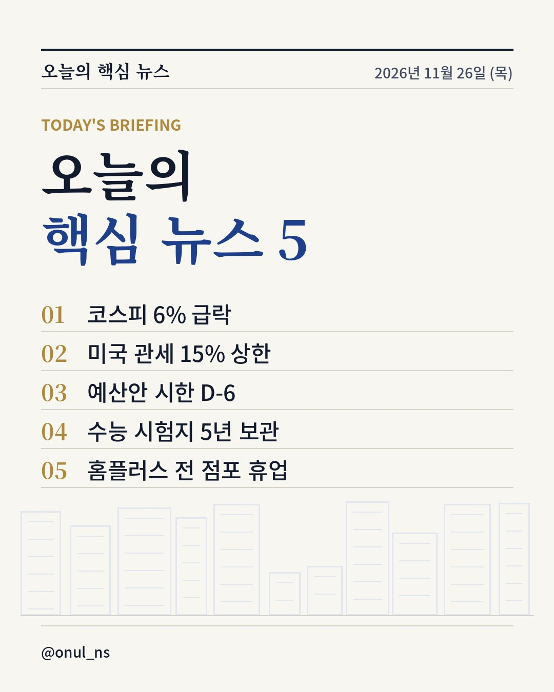
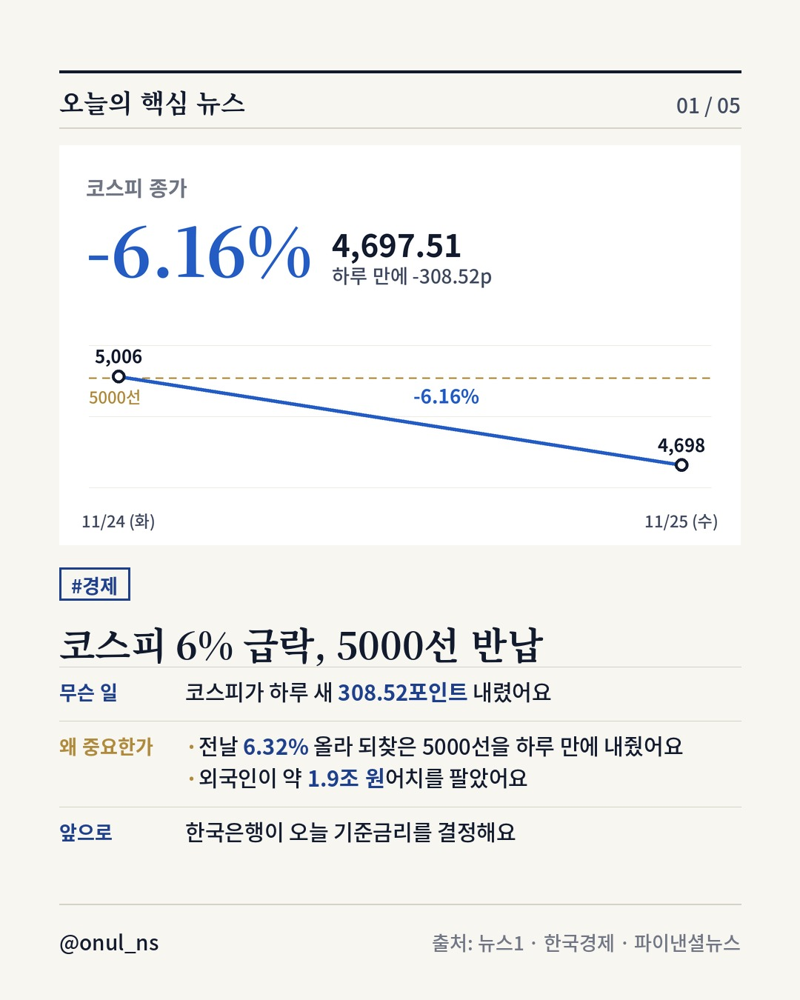
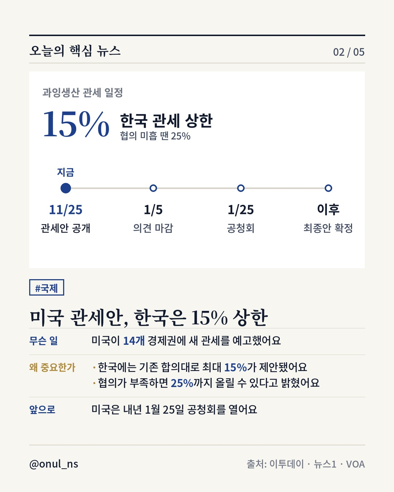
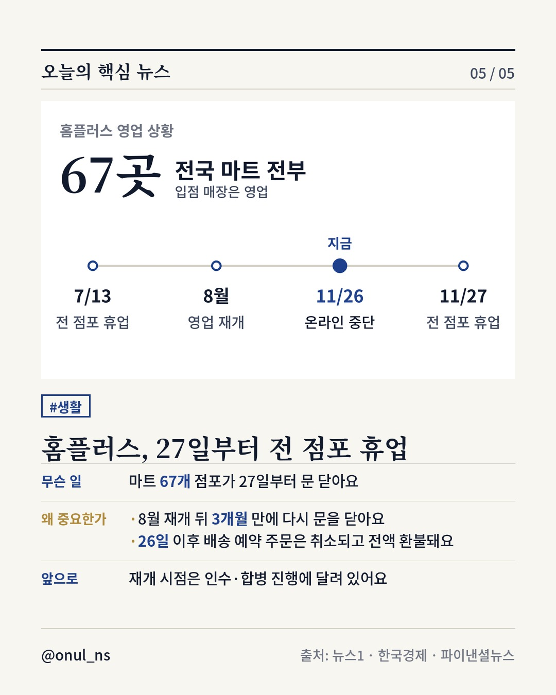
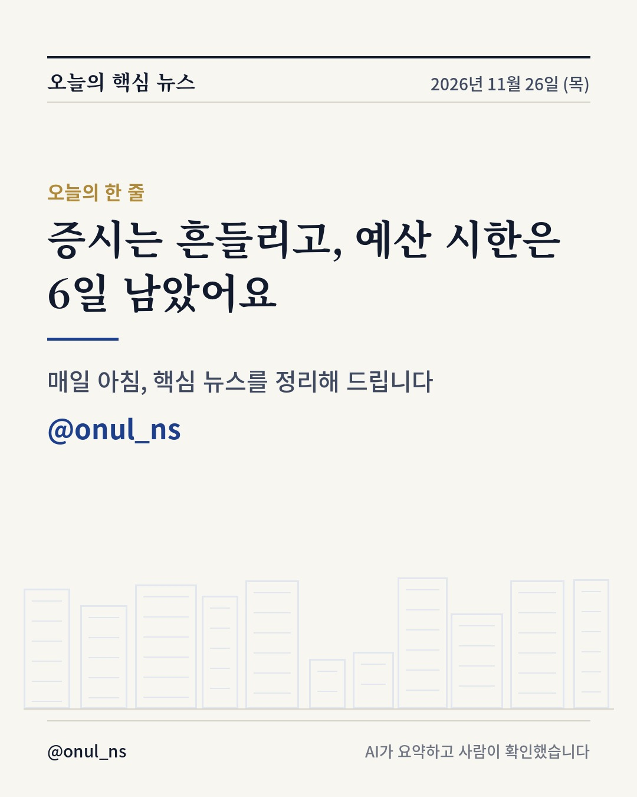

# 11월 26일 (목) 오늘의 핵심 뉴스

[← 보관함 목차](../README.md)

## 카드









## 캡션 (그대로 복사)

```
코스피가 하루 새 6.16% 내려 4,697.51에 마감했어요.
미국이 14개 경제권에 과잉생산 관세를 예고했고, 한국에는 최대 15%가 제안됐어요.
내년 예산안 법정 처리 시한(12월 2일)이 6일 남았지만 여야는 162조 원 미래대응기금을 두고 맞서고 있어요.
교육부가 수능 시험지 보관 기간을 1년에서 5년으로 늘리는 방안을 추진해요.
홈플러스가 상품 살 돈이 부족해 27일부터 전국 67개 점포 영업을 멈춰요.

출처: 뉴스1 · 한국경제 · 파이낸셜뉴스 · 이투데이 · VOA · 디지털타임스 · 서울신문 · 아시아경제
※ AI가 요약하고 사람이 확인했습니다

#오늘의뉴스 #시사 #뉴스요약 #코스피 #관세 #예산안 #국회 #수능 #홈플러스 #카드뉴스
```

## 왜 이 뉴스인가 (게시용 아님)

1. **코스피 6% 급락, 5000선 반납** (중요): 하루에 6% 넘게 떨어졌고 여러 언론이 톱뉴스로 다뤘어요. 주식을 가진 사람이 많아 영향이 커요. · 출처 뉴스1 · 한국경제 · 파이낸셜뉴스
2. **미국 관세안, 한국은 15% 상한** (중요): 한국 수출 전반에 걸린 국제 뉴스예요. · 출처 이투데이 · 뉴스1 · VOA
3. **예산안 시한 D-6, 기금 놓고 이견** (중요): 약 821조 원 예산의 처리 일정이 걸려 있어요. 양측 입장을 나란히 적었어요. · 출처 디지털타임스 · 서울신문 · 뉴스1
4. **수능 시험지 보관, 1년→5년 추진** (흥미): 20대와 가까운 주제이고 AI 기기를 쓴 부정행위 의혹과 이어져요. · 출처 이투데이 · 파이낸셜뉴스 · 아시아경제
5. **홈플러스, 27일부터 전 점포 휴업** (중요): 내일부터 장보기와 온라인 주문 환불에 바로 영향이 있어요(생활). · 출처 뉴스1 · 한국경제 · 파이낸셜뉴스

## 사실 확인 결과 (게시용 아님)

※ 기사 원문 대신 검색 결과로 확인(RSS·기사 내려받기·WebFetch 모두 막힘). 이슈마다 언론사 3곳.
※ 예약 작업 시험 실행(08:28 시작)이 만든 문구로, 보관함용 이미지는 같은 문구로 다시 그렸어요.

1. 코스피: 종가 4,697.51, 하락 308.52p(6.16%), 전날 종가 5006.03과 상승률 6.32%는 세 곳이 같음. 외국인 순매도는 1조8993억·1조9085억·2조2711억으로 엇갈려 '약 1.9조 원'. 한국은행 오늘 기준금리 결정은 뉴스웍스·업코리아 아침 브리핑으로 확인.
https://www.news1.kr/finance/market-exr/6365864
https://www.hankyung.com/article/202611259903i
https://www.fnnews.com/news/202611252310100567

2. 미국 관세안: 14개 경제권, 한국 최대 15%, 협의 미흡 시 25%, 1월 5일 의견 마감, 1월 25일 공청회는 세 곳이 같음. '이후 최종안 확정'은 날짜 미정.
https://www.etoday.co.kr/news/view/2653055
https://www.news1.kr/world/usa-canada/6366285
https://www.voakorea.com/a/8227899.html

3. 예산안: 예산 규모가 820조9000억 원과 821조9000억 원으로 엇갈려 '약 821조 원'. 공식 수치 확인 필요. 기금 162조 원과 시한 12월 2일은 여러 곳 일치. D-6은 26일부터 12월 2일까지 계산.
https://www.dt.co.kr/article/12097215
https://www.seoul.co.kr/news/politics/2026/11/26/20261126003004
https://www.news1.kr/politics/assembly/6364129

4. 수능 시험지: 1,310곳 중 1,077곳(82.2%) 보관, 233곳(17.8%) 폐기(교육부 발표 보도).
https://www.etoday.co.kr/news/view/2652646
https://www.fnnews.com/news/202611251330438118
https://view.asiae.co.kr/article/2026112509555542529

5. 홈플러스: 67개 점포, 27일 휴업, 26일 온라인 배송 중단과 예약 주문 전액 환불은 여러 곳 일치. 7월 13일 휴업·8월 재개는 대구신문·재경일보.
https://www.news1.kr/industry/distribution/6365918
https://www.hankyung.com/article/202611259868g
https://www.fnnews.com/news/202611251535440911

뺀 뉴스: 윤석열 전 대통령 위증 사건 대법원 선고(오전 10시 15분 선고라 결과 없음), 공군 중사 사망(사망 사건 제외 규칙), 연예인 드레스·재벌가 이혼 소송(연예·사생활).
카드 확인: 처음에 '美'가 글꼴에 없어 네모로 나와 '미국'으로 고침.
