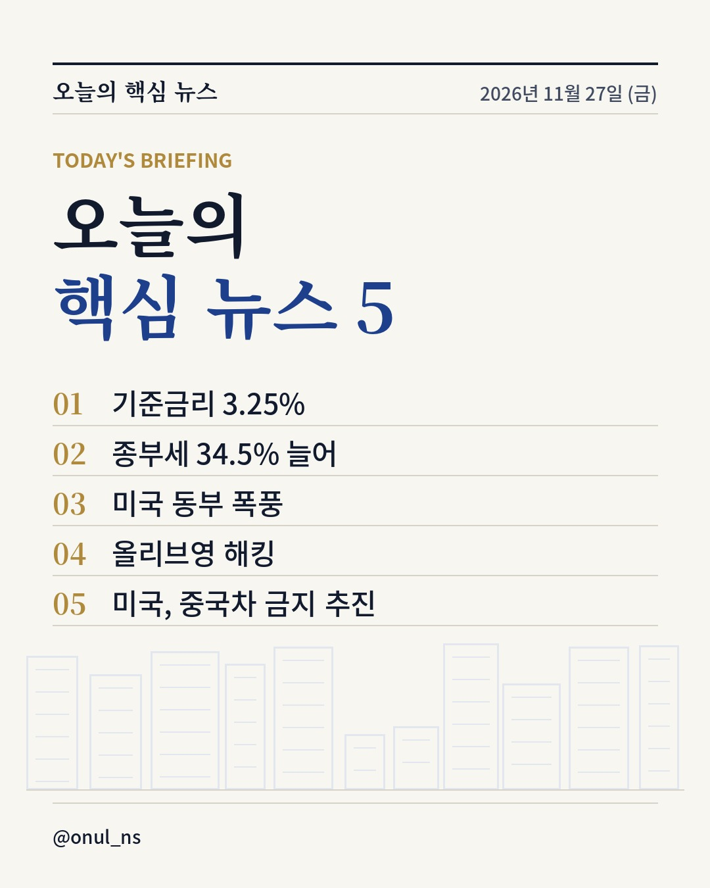
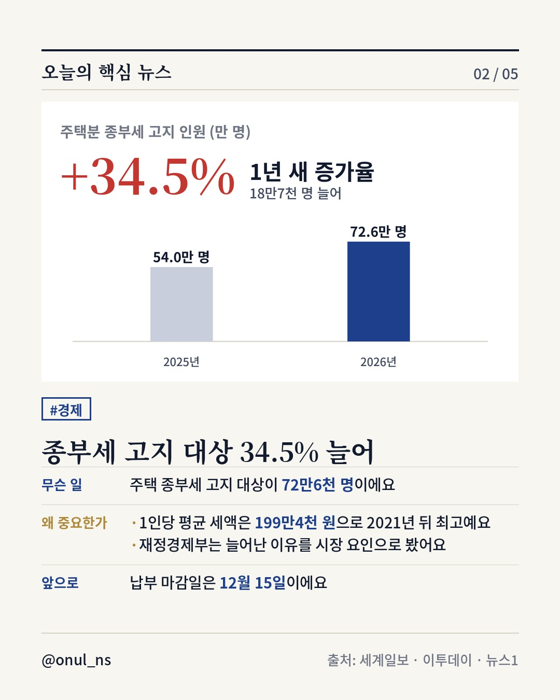
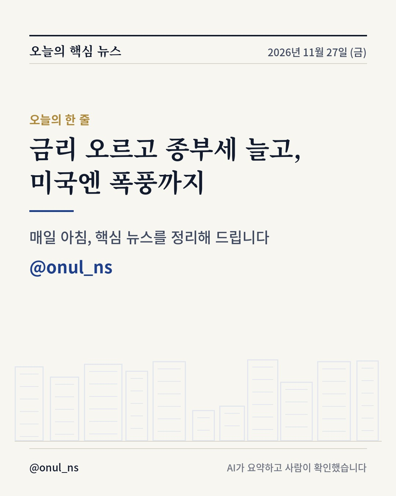

# 11월 27일 (금) 오늘의 핵심 뉴스

[← 보관함 목차](../README.md)

## 카드








## 캡션 (그대로 복사)

```
한국은행이 기준금리를 3.00%에서 3.25%로 0.25%포인트 올렸어요.
올해 주택분 종부세 고지 대상은 72만6천 명으로 1년 새 34.5% 늘었어요.
추수감사절 폭풍으로 미국 동부 55만 곳 넘게 정전되고 항공편 400편 넘게 결항됐어요.
CJ올리브영 업무시스템이 해킹돼 790명의 개인정보가 유출됐어요.
미국 의회가 중국 부품을 쓴 차의 미국 판매를 막는 법안을 연내 처리하려 해요.

출처: 뉴스1 · 이투데이 · 세계일보 · 경향신문 · 매일경제 · SBS · 한국경제 · 연합뉴스
※ AI가 요약하고 사람이 확인했습니다

#오늘의뉴스 #시사 #뉴스요약 #기준금리 #종부세 #미국폭풍 #올리브영 #개인정보 #미중관계 #카드뉴스
```

## 왜 이 뉴스인가 (게시용 아님)

1. **기준금리 3.25%로 인상** (중요): 대출·예금 이자에 바로 영향, 어제 가장 많은 언론이 다룬 경제 뉴스 · 출처 뉴스1 · 이투데이 · 세계일보
2. **종부세 고지 대상 34.5% 늘어** (중요): 집을 가진 72만 명에게 고지서가 나간 세금 소식, 12월 15일 납부 마감 · 출처 세계일보 · 이투데이 · 뉴스1
3. **미국 동부 폭풍, 55만 곳 정전** (중요): 재해: 55만 곳 정전·항공편 400편 결항, 연휴 미국 여행객에게 직접 영향 · 출처 경향신문 · 매일경제
4. **올리브영 해킹, 790명 정보 유출** (흥미): 20대가 많이 쓰는 올리브영의 개인정보 유출, 사칭 문자 주의 · 출처 SBS · 이투데이 · 한국경제
5. **미국 의회, 중국차 판매 금지 추진** (중요): 미국·중국 무역 휴전 종료(1월 10일)를 앞둔 미국 의회의 대중국 법안 · 출처 연합뉴스 · 경향신문

## 사실 확인 결과 (게시용 아님)

금리·종부세·올리브영은 검색 결과로 확인했고, 폭풍·중국차 법안은 기사 원문을 직접 저장해 확인했어요(언론사 접속 허용 뒤).

1. 기준금리 3.25% 인상 (뉴스1 · 이투데이 · 세계일보, 한국은행 26일 결정)
https://www.news1.kr/economy/trend/6366389
https://www.etoday.co.kr/news/view/2653240
https://www.segye.com/newsView/20261126507219
- 3.00%에서 3.25%, 0.25%p, 7명 중 2명 동결 의견, 올해 성장률 전망 3.9%: 여러 곳 같음

2. 종부세 고지 대상 34.5% 늘어 (세계일보 · 이투데이 · 뉴스1, 재정경제부·국세청 26일 발표)
https://www.segye.com/newsView/20261126515083
https://www.etoday.co.kr/news/view/2653622
https://www.news1.kr/economy/trend/6366629
- 그래프 72.6만 명 = 기사 '72만6천명'을 만 명 단위로 바꾼 값, 54.0만 명 = 세계일보 '작년(54만명)'

3. 미국 동부 폭풍 (경향신문 · 매일경제, 원문 저장)
https://www.khan.co.kr/article/202611270749001/
https://www.mk.co.kr/news/world/12219816
- 55만 곳 넘게 정전, 400편 넘게 결항, 약 1600편 지연, 메릴랜드·버지니아 집중, 전력회사 도미니언 '복구에 수일': 두 곳 같음

4. CJ올리브영 해킹 (SBS · 이투데이 · 한국경제)
https://news.sbs.co.kr/news/endPage.do?news_id=N1008865937
https://www.etoday.co.kr/news/view/2653668
https://www.hankyung.com/article/2026112634721
- 790명(임직원 639, 협력사 106, 고객 45), 234만4549건: 여러 곳 같음

5. 미국 의회 중국차 판매 금지 법안 (연합뉴스 · 경향신문, 원문 저장, 폴리티코 26일 보도 인용)
https://www.yna.co.kr/view/AKR20261127010700071
https://www.khan.co.kr/article/202611270828001/
- 공화·민주 의원 공동 발의, 7월 상원 상무위 통과, 무역 휴전 1월 10일 종료: 두 곳 같음
- '12월' = 기사의 '다음 달'(11월 기사 기준), D-44 = 11월 27일부터 1월 10일까지 44일(계산)

뺀 뉴스
- 철도노조 준법투쟁 첫날: 어제 카드와 같은 흐름(새 기준: 어제와 겹치면 큰 변화가 있을 때만)
- 트럼프 '선거 전 성장률은 가짜' 주장: 다음 일정 확인 못 함
- 홈플러스 휴업 시작: 어제 카드에서 다뤘음
- 서울 여인숙 화재(1명 사망), 남경주 재판: 사망 사고·범죄 상세 내용이라 제외

check_cards.py 최종 결과: 통과 (주의 2개: 그래픽 72.6은 단위 변환, '12월'은 '다음 달'을 날짜로 바꾼 값)
