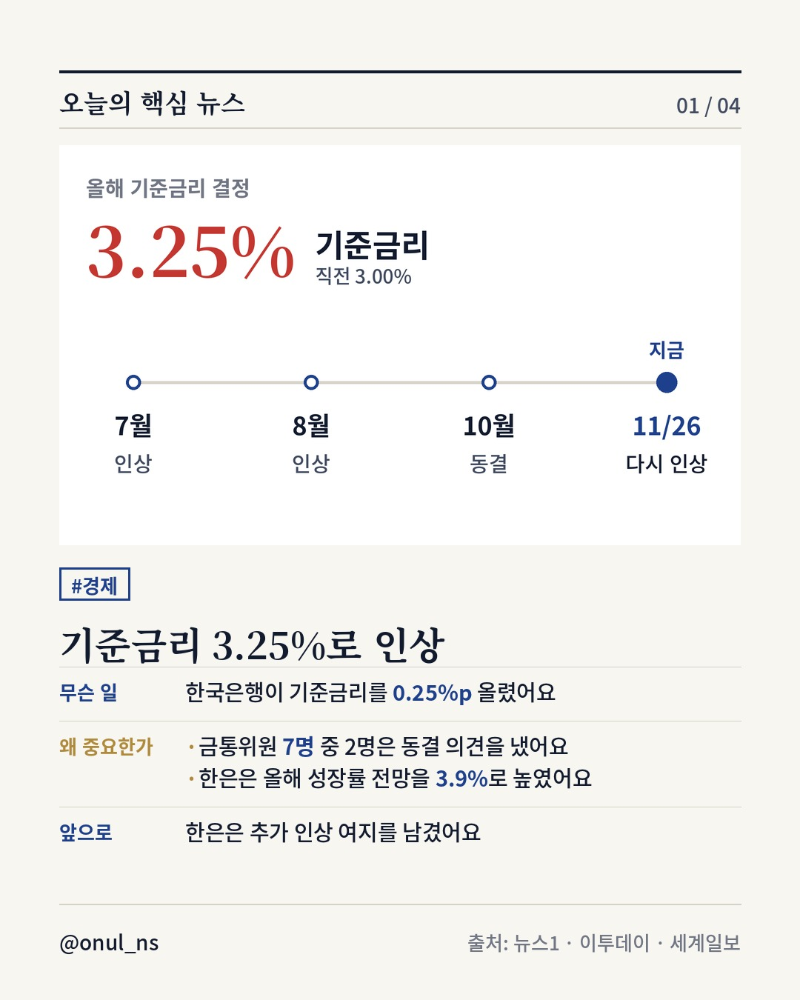
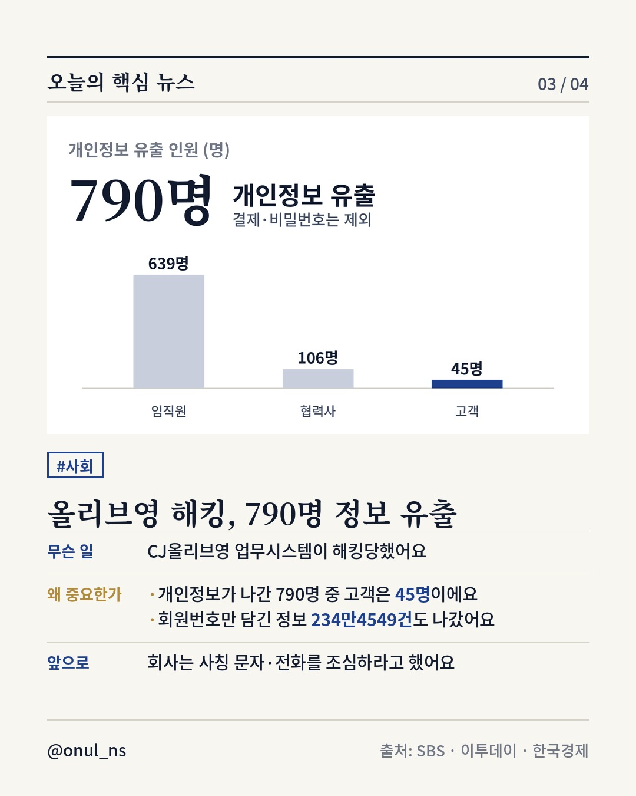
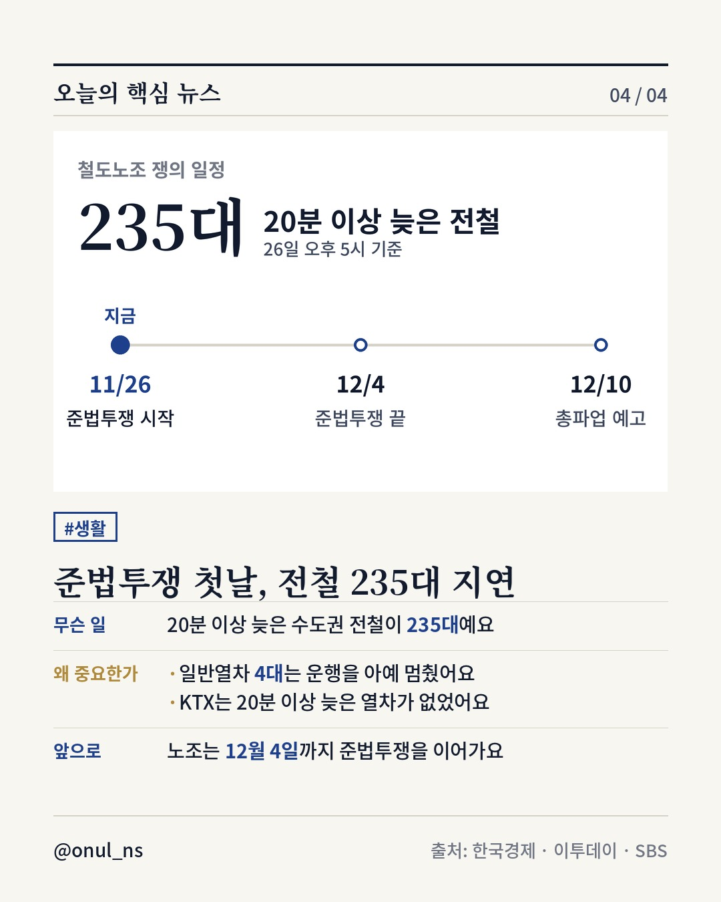
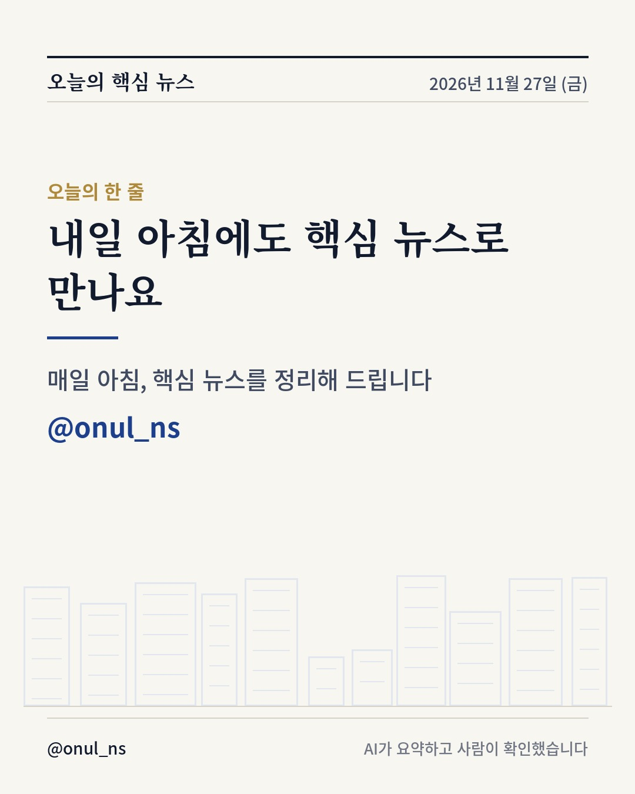

# 11월 27일 (금) 오늘의 핵심 뉴스

[← 보관함 목차](../README.md)

## 카드








## 캡션 (그대로 복사)

```
한국은행이 기준금리를 3.00%에서 3.25%로 0.25%포인트 올렸어요.
올해 주택분 종부세 고지 대상은 72만6천 명으로 1년 새 34.5% 늘었어요.
CJ올리브영 업무시스템이 해킹돼 790명의 개인정보가 유출됐어요.
철도노조 준법투쟁 첫날 수도권 전철 235대가 20분 이상 늦었어요.

출처: 뉴스1 · 이투데이 · 세계일보 · SBS · 한국경제
※ AI가 요약하고 사람이 확인했습니다

#오늘의뉴스 #시사 #뉴스요약 #기준금리 #한국은행 #종부세 #올리브영 #개인정보 #철도노조 #카드뉴스
```

## 왜 이 뉴스인가 (게시용 아님)

1. **기준금리 3.25%로 인상** (중요): 대출·예금 이자에 바로 영향, 어제 가장 많은 언론이 다룬 경제 뉴스 · 출처 뉴스1 · 이투데이 · 세계일보
2. **종부세 고지 대상 34.5% 늘어** (중요): 집을 가진 72만 명에게 고지서가 나간 세금 소식, 다음 달 15일이 납부 마감 · 출처 세계일보 · 이투데이 · 뉴스1
3. **올리브영 해킹, 790명 정보 유출** (흥미): 20대가 많이 쓰는 올리브영의 개인정보 유출, 사칭 문자 주의 · 출처 SBS · 이투데이 · 한국경제
4. **준법투쟁 첫날, 전철 235대 지연** (중요): 수도권 출퇴근 전철 이용자에게 직접 영향, 12월 4일까지 계속 · 출처 한국경제 · 이투데이 · SBS

## 사실 확인 결과 (게시용 아님)

기사 원문 접속이 막혀(언론사 사이트 차단) 기사 원문 대신 검색 결과로 확인했어요. 이슈마다 서로 다른 언론사 3곳 이상의 검색 결과(제목·날짜·인용문)를 저장했어요.
오늘은 확인된 뉴스가 4개라 4개만 만들었어요(아래 '뺀 뉴스' 참고).

1. 기준금리 3.25% 인상 (뉴스1 · 이투데이 · 세계일보, 한국은행 26일 결정)
https://www.news1.kr/economy/trend/6366389
https://www.etoday.co.kr/news/view/2653240
https://www.segye.com/newsView/20261126507219
- 3.00%에서 3.25%, 0.25%p, 7명 중 5명 찬성(2명 동결 의견), 올해 성장률 전망 3.3%에서 3.9%: 여러 곳 같음
- 7월·8월 인상, 10월 동결: 뉴스1
- 추가 인상 여지: 결정문에서 '속도' 문구 삭제(뉴스1), 점도표 21개 중 15개가 3.25%보다 높음(이투데이)

2. 종부세 고지 대상 34.5% 늘어 (세계일보 · 이투데이 · 뉴스1, 재정경제부·국세청 26일 발표)
https://www.segye.com/newsView/20261126515083
https://www.etoday.co.kr/news/view/2653622
https://www.news1.kr/economy/trend/6366629
- 주택분 72만6천 명, 34.5%, 18만7천 명 증가, 1인당 평균 199만4천 원(2021년 이후 최고), 12월 15일 납부: 여러 곳 같음
- 그래프의 2025년 54.0만 명: 세계일보 '작년(54만명)'
- 고지 인원이라 특례 신청 뒤 최종 인원은 줄 수 있어요(뉴스1). 그래서 제목을 '고지 대상'으로 썼어요

3. CJ올리브영 해킹 (SBS · 이투데이 · 한국경제)
https://news.sbs.co.kr/news/endPage.do?news_id=N1008865937
https://www.etoday.co.kr/news/view/2653668
https://www.hankyung.com/article/2026112634721
- 790명(임직원 639, 협력사 106, 고객 45), 회원번호만 담긴 정보 234만4549건, 결제·비밀번호는 유출 안 됨: 여러 곳 같음

4. 철도노조 준법투쟁 첫날 (한국경제 · 이투데이 · SBS · 뉴스1, 코레일 집계)
https://www.hankyung.com/article/2026112632667
https://www.etoday.co.kr/news/view/2653645
https://news.sbs.co.kr/news/endPage.do?news_id=N1008865616
- 26일 오후 5시 기준 전철 235대 20분 이상 지연, 일반열차 4대 운행 중지, 12월 4일까지, 12월 10일 총파업 예고: 여러 곳 같음
- 이투데이는 전체를 239대로 셈(235+4). 카드는 공식 집계대로 전철 235대로 씀

뺀 뉴스
- 트럼프 '선거 전 3분기 성장률은 가짜' 조사 요구: 두 곳에서 확인됐지만 다음 일정(앞으로)을 확인할 수 없어 뺌
- 홈플러스 오늘부터 휴업: 어제 카드에서 다뤘음
- 조희대 대법원장 탄핵 추진: 새 소식이 20~23일 기사뿐이라 날짜 기준에 맞지 않음
- 제주 중학생 사망: 사망 사건이라 넣지 않음

참고: 금리·종부세·철도는 26일 낮 발표라 '어제 저녁 이후' 기준보다 조금 이르지만, 최근 24시간 안의 소식이고 26일 저녁까지 후속 보도가 이어져 넣었어요.

check_cards.py 최종 결과: 통과 (주의 1개: 뉴스가 4개)
