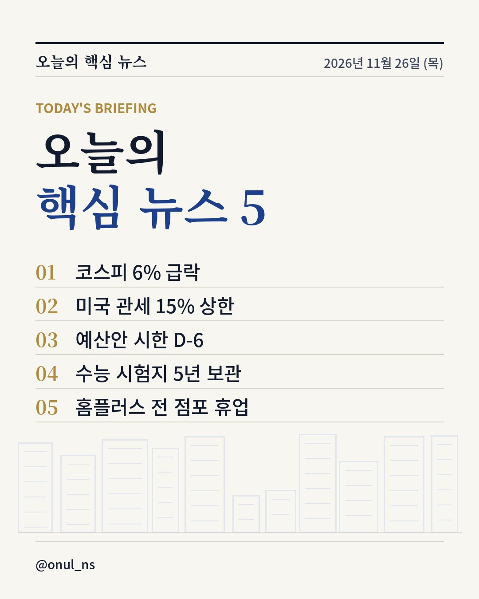
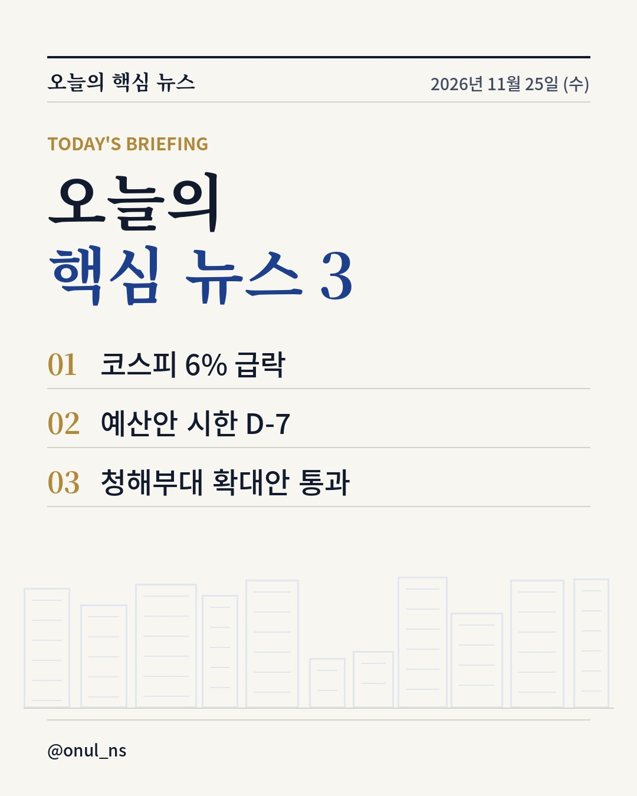

# 카드뉴스 보관함

매일 아침 예약 작업이 만든 @onul_ns 카드뉴스를 날짜별로 모아 둔 곳이에요. 날짜를 누르면 카드 7장, 캡션, 고른 이유, 사실 확인 결과가 나와요.

| 날짜 | 표지 | 뉴스 | 상태 |
|---|---|---|---|
<!-- rows -->
| [2026-11-26](2026-11-26/README.md) |  | 코스피 6% 급락, 5000선 반납 · 미국 관세안, 한국은 15% 상한 · 예산안 시한 D-6, 기금 놓고 이견 · 수능 시험지 보관, 1년→5년 추진 · 홈플러스, 27일부터 전 점포 휴업 | ✅ 5개 |
| [2026-11-25](2026-11-25/README.md) |  | 코스피 6% 폭락, 전날 상승분 반납 · 예산안 시한 D-7, 여야 대치 계속 · 청해부대 작전구역 확대안 소위 통과 | ✅ 3개 |
