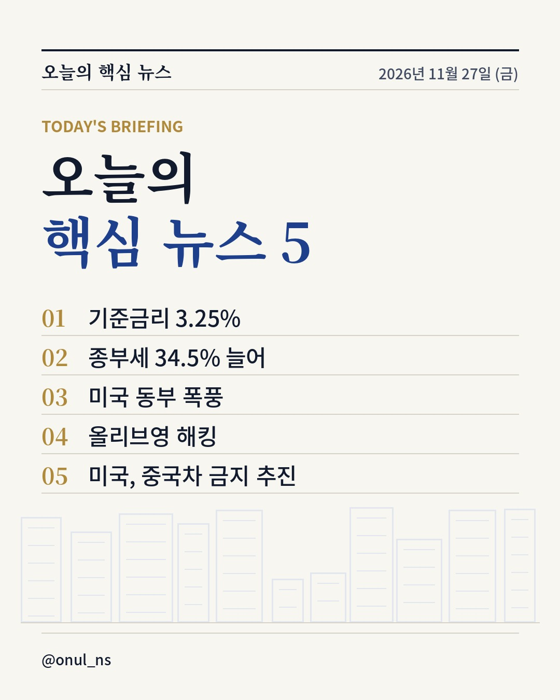

# 카드뉴스 보관함

매일 아침 예약 작업이 만든 @onul_ns 카드뉴스를 날짜별로 모아 둔 곳이에요. 날짜를 누르면 카드, 캡션, 고른 이유, 사실 확인 결과가 나와요.

| 날짜 | 표지 | 뉴스 | 상태 |
|---|---|---|---|
<!-- rows -->
| [2026-11-27](2026-11-27/README.md) |  | 기준금리 3.25%로 인상 · 종부세 고지 대상 34.5% 늘어 · 미국 동부 폭풍, 55만 곳 정전 · 올리브영 해킹, 790명 정보 유출 · 미국 의회, 중국차 판매 금지 추진 | ✅ 5개 |
| [2026-11-26](2026-11-26/README.md) |  | 새 미국 관세, 한국은 15% 유지 · 대출 금리 5% 돌파, 오늘 금통위 · 철도노조 준법투쟁, 열차 지연 우려 · 북한, 스위스 외교사무소 폐쇄 · 홈플러스, 내일부터 전 점포 휴업 | ✅ 5개 |
| [2026-11-25](2026-11-25/README.md) |  | 코스피 6% 폭락, 전날 상승분 반납 · 예산안 시한 D-7, 여야 대치 계속 · 청해부대 작전구역 확대안 소위 통과 | ✅ 3개 |
